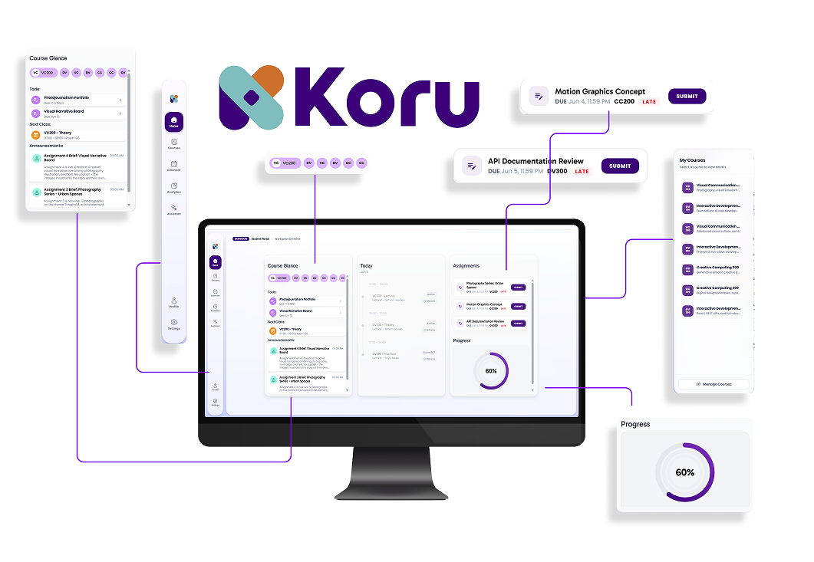
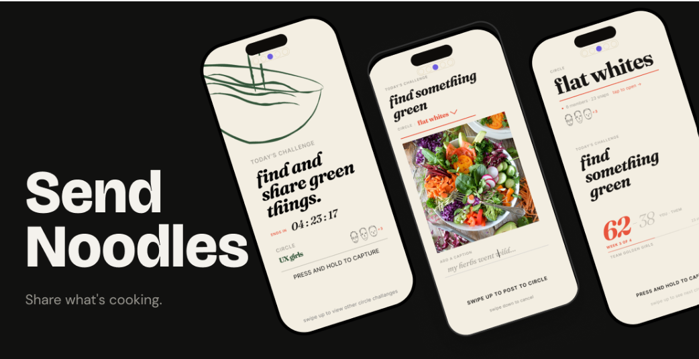
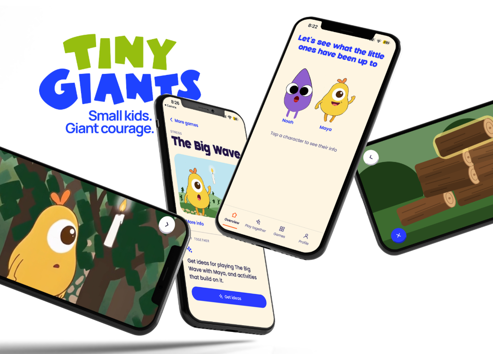

<!-- ================= HEADER IMAGE ================= -->

---

## About Me

Hi, I'm Danae! I'm a developer and UI/UX designer trained at **Open Window**, where I learned to build things that work well *and* look good doing it.

I design with the user in mind and code with a creative eye, so my projects tend to land somewhere between functional and a little unexpected. I work across web, mobile, desktop and full-stack builds, from Figma to deployed.

When I'm not coding, I'm painting murals, dancing, or hunting for new music. Art keeps my designs bold, and code keeps my art… slightly more organised.

Everything I build works. Most of the time. :)

---

## Tech Stack

**Languages & Frameworks**  

**Data & Backend Services**  

**Design, Testing & Tools**  

**Deployment & Hosting**  

---

## Featured Projects

### Koru

**A full-stack Learning Management System, delivered as a native desktop app for Windows and macOS.** Koru brings teaching, scheduling, assessment and admin into one platform, with a tailored portal for students, teachers and admins.

- **Auto-generated timetable:** a constraint-based scheduler that avoids teacher, room and student-group clashes
- **Assessment pipeline:** assignments → submissions → grades → feedback, with grades hidden until released
- **Code/QR attendance check-in**, analytics dashboards and an AI assistant that uses the user's own course data
- **Secure by design:** role-based access, BCrypt, optional two-factor authentication, Google sign-in and POPIA compliance

**Built with:** Electron · React 19 · Vite · Tailwind + DaisyUI · ASP.NET Core (.NET 10) · PostgreSQL · Docker · Groq (Llama 3.1)

[View Repo](https://github.com/corbyn-jpg/learn-online.git)

---

### Send Noodles

**A social, challenge-based mobile app for friend groups.** Friends join a "circle" with an invite code, agree on a challenge with a prize or wager attached ("loser buys drinks"), and complete it by snapping and sending photos.

- **Snap & Send:** in-app camera (shake to flip), captions and polaroid-style gallery frames you can rearrange
- **Circles & challenges:** shared prompt bank, points scoreboard and countdown, plus a solo daily challenge
- **Rewards & memories:** unlockable frame styles and a private archive of everything you've sent
- **Serverless:** Firebase with Firestore rules enforcing challenge states and reward payouts. All artwork is original.

**Built with:** Expo / React Native · TypeScript · React Navigation · Reanimated · Firebase · Cloudinary

[View Repo](https://github.com/danaeswart/send-noodles.git)

---

### Tiny Giants

**A story-game app that helps children aged 4–5 cope with big feelings.** Kids play through a calm, unfailable storybook while a PIN-protected grown-up side handles profiles, game choices and play history.

- **Child view:** in *The Big Wave*, Cami travels through a forest, beach and big wave, with a paced breathing guide and large, easy-to-tap controls
- **Grown-up view:** child profiles, per-child game selection, play history and an **AI parent coach** that suggests activities to play together
- **Safe AI:** a Cloudflare Worker keeps the Gemini key off the device and verifies the parent's Firebase sign-in
- One codebase for iOS, Android and web

**Built with:** Expo (SDK 58) / React Native · Expo Router · Reanimated · Firebase · Cloudflare Workers · Google Gemini · Jest

[Live Demo](https://tiny-giants-178da.web.app) · [View Repo](https://github.com/danaeswart/Tiny-Giants.git)

---

## GitHub Activity

---

## Thank You

Thank you to **Open Window** and my **lecturers** for the guidance, feedback and learning environment behind these projects.

## Contact

📧 [danaeswart003@gmail.com](mailto:danaeswart003@gmail.com)
